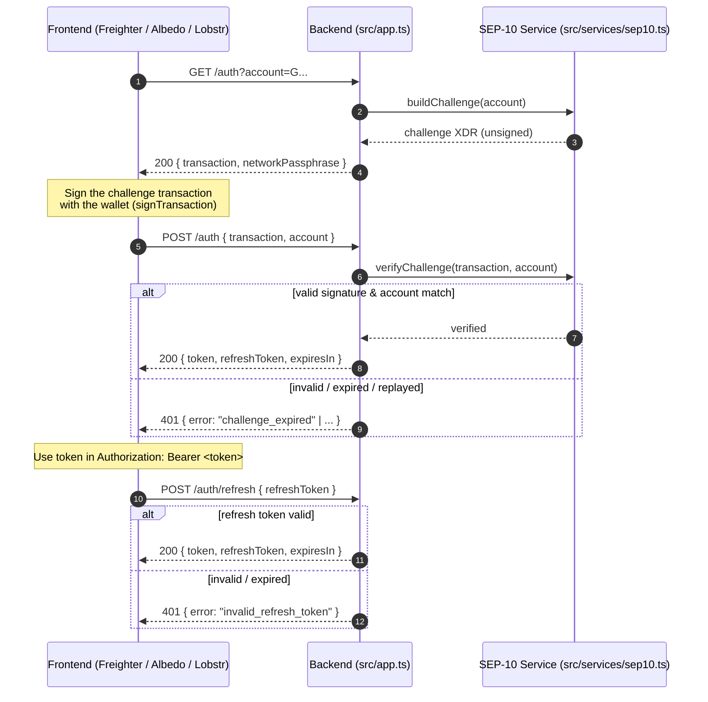

# Backend Wallet Login (SEP-10)

This guide describes the backend endpoints that implement wallet-based authentication using [SEP-10](https://github.com/stellar/stellar-protocol/blob/master/ecosystem/sep-0010.md). It is aimed at frontend developers integrating Freighter, Albedo, or Lobstr.

The flow is:

1. Request a challenge transaction for the user's Stellar account.
2. Sign the challenge with the wallet.
3. Submit the signed challenge to receive an access token and a refresh token.
4. Use the access token on authenticated requests, and refresh it before it expires.

---

## Sequence Diagram



---

## Endpoints

### 1. `GET /auth?account=<G...>`

Issues a SEP-10 challenge transaction for the given Stellar account. The transaction is unsigned; the client must sign it with the wallet.

**Request**

```bash
curl -s "https://api.example.com/auth?account=GABCD...XYZ"
```

**Response `200 OK`**

```json
{
  "transaction": "AAAAAgAAAAB...base64-xdr...",
  "networkPassphrase": "Test SDF Network ; September 2015"
}
```

**Validation errors (`400 Bad Request`)**

| Error | Meaning |
| --- | --- |
| `missing_account` | The `account` query parameter is absent. |
| `invalid_account` | The `account` value is not a valid Stellar public key. |

---

### 2. `POST /auth`

Verifies the signed challenge and, on success, returns an access token and a refresh token.

**Request**

```bash
curl -s -X POST "https://api.example.com/auth" \
  -H "Content-Type: application/json" \
  -d '{
    "transaction": "AAAAAgAAAAB...signed-base64-xdr...",
    "account": "GABCD...XYZ"
  }'
```

**Response `200 OK`**

```json
{
  "token": "eyJhbGciOiJIUzI1NiIsInR5cCI6IkpXVCJ9...",
  "refreshToken": "eyJhbGciOiJIUzI1NiIsInR5cCI6IkpXVCJ9...",
  "expiresIn": 900
}
```

`expiresIn` is the access token lifetime in seconds (see [Token Lifetimes](#token-lifetimes)).

**Validation errors (`400 Bad Request`)**

| Error | Meaning |
| --- | --- |
| `missing_transaction` | The `transaction` field is absent. |
| `missing_account` | The `account` field is absent. |
| `invalid_account` | The `account` value is not a valid Stellar public key. |

**Authentication errors (`401 Unauthorized`)**

| Error | Meaning |
| --- | --- |
| `invalid_challenge` | The transaction is malformed or is not a valid SEP-10 challenge. |
| `challenge_expired` | The challenge's time bounds have passed; request a new one. |
| `challenge_replayed` | The challenge has already been used; request a new one. |
| `account_mismatch` | The challenge's source account does not match the submitted `account`. |
| `bad_signature` | The transaction signature could not be verified against the account. |

---

### 3. `POST /auth/refresh`

Exchanges a valid refresh token for a new access token (and a new refresh token).

**Request**

```bash
curl -s -X POST "https://api.example.com/auth/refresh" \
  -H "Content-Type: application/json" \
  -d '{
    "refreshToken": "eyJhbGciOiJIUzI1NiIsInR5cCI6IkpXVCJ9..."
  }'
```

**Response `200 OK`**

```json
{
  "token": "eyJhbGciOiJIUzI1NiIsInR5cCI6IkpXVCJ9...",
  "refreshToken": "eyJhbGciOiJIUzI1NiIsInR5cCI6IkpXVCJ9...",
  "expiresIn": 900
}
```

**Validation errors (`400 Bad Request`)**

| Error | Meaning |
| --- | --- |
| `missing_refresh_token` | The `refreshToken` field is absent. |

**Authentication errors (`401 Unauthorized`)**

| Error | Meaning |
| --- | --- |
| `invalid_refresh_token` | The refresh token is malformed, expired, or otherwise invalid. |

---

## Error Code Summary

| Error code | HTTP status | Endpoint | Meaning |
| --- | --- | --- | --- |
| `missing_account` | 400 | `GET /auth`, `POST /auth` | Required `account` is missing. |
| `invalid_account` | 400 | `GET /auth`, `POST /auth` | `account` is not a valid Stellar public key. |
| `missing_transaction` | 400 | `POST /auth` | Required `transaction` is missing. |
| `missing_refresh_token` | 400 | `POST /auth/refresh` | Required `refreshToken` is missing. |
| `invalid_challenge` | 401 | `POST /auth` | Transaction is malformed or not a valid SEP-10 challenge. |
| `challenge_expired` | 401 | `POST /auth` | Challenge time bounds have passed. |
| `challenge_replayed` | 401 | `POST /auth` | Challenge has already been consumed. |
| `account_mismatch` | 401 | `POST /auth` | Challenge source account does not match `account`. |
| `bad_signature` | 401 | `POST /auth` | Signature verification failed. |
| `invalid_refresh_token` | 401 | `POST /auth/refresh` | Refresh token is malformed or expired. |

---

## Token Lifetimes

- **Access token** — short-lived, capped at **15 minutes** (900 seconds). Controlled by `ACCESS_TOKEN_TTL_SECONDS`; values above 900 are clamped to 900. The lifetime is returned to the client as `expiresIn`.
- **Refresh token** — defaults to **7 days**. Used only against `POST /auth/refresh`.

Clients should refresh proactively before `expiresIn` elapses.

### Environment Variables

| Variable | Purpose |
| --- | --- |
| `JWT_SECRET` | Secret used to sign and verify access and refresh tokens. |
| `SEP10_SIGNING_SECRET` | Server keypair secret used to build and sign SEP-10 challenge transactions. |
| `HOME_DOMAIN` | The home domain embedded in the challenge's manage-data operation. |
| `WEB_AUTH_DOMAIN` | The `web_auth_domain` client domain attribute in the challenge. |
| `STELLAR_NETWORK` | Target network (`testnet` / `pubnet`); determines the network passphrase. |
| `ACCESS_TOKEN_TTL_SECONDS` | Access token lifetime in seconds (capped at 900). |
| `ADMIN_ADDRESS` | Stellar account granted the `admin` role. |

---

## Role Derivation

The authenticated account's role is derived on each request, in priority order (highest wins):

1. **admin** — the account equals `ADMIN_ADDRESS`.
2. **validator** — the account is a registered validator.
3. **scout** — the account is a registered scout.
4. **player** — the account is a registered player.
5. **unknown** — the account is authenticated but has no assigned role.

---

## Notes

- Always request a fresh challenge for each login attempt; challenges are single-use (`challenge_replayed`).
- Treat `challenge_expired` and `challenge_replayed` as signals to restart the flow from `GET /auth`.
- Treat `invalid_refresh_token` as a signal to log the user out and restart from `GET /auth`.
- Send the access token as `Authorization: Bearer <token>` on authenticated requests.